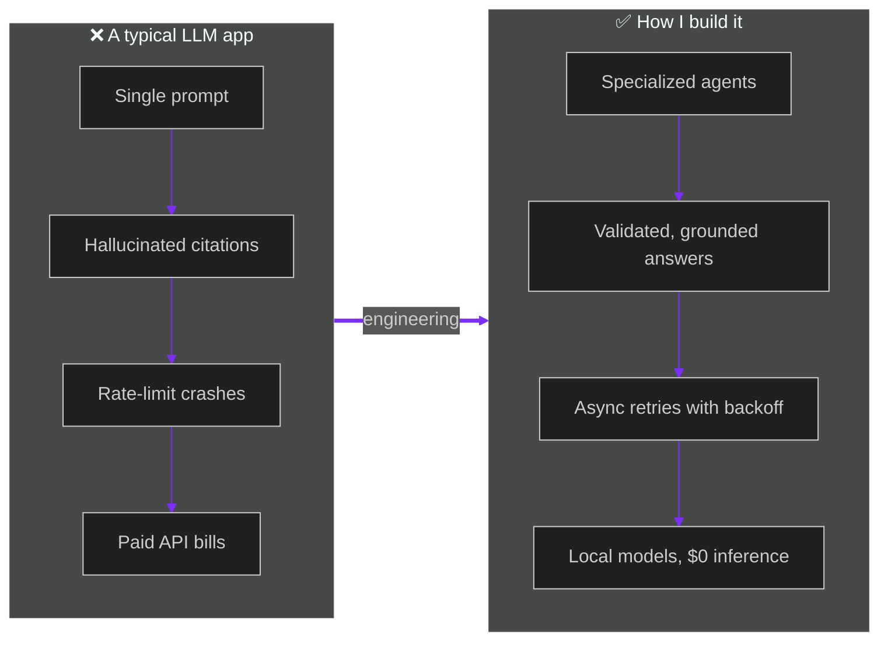
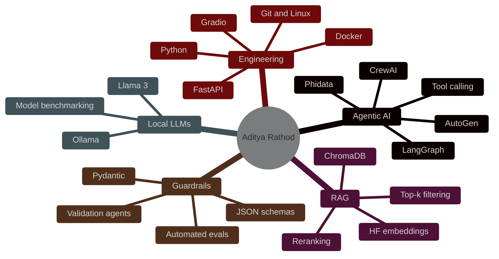
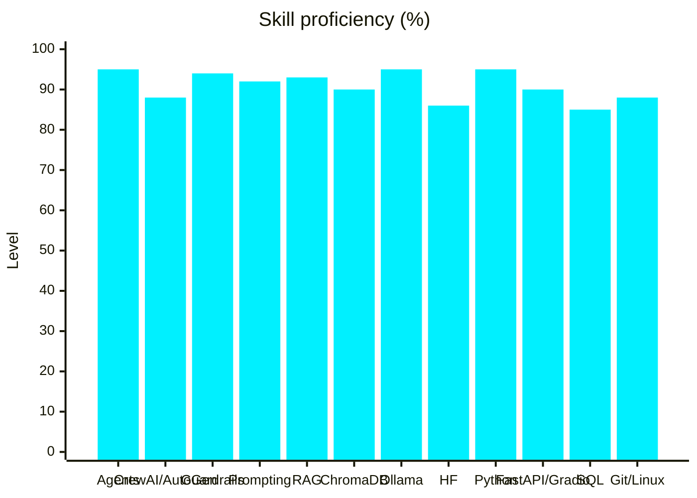
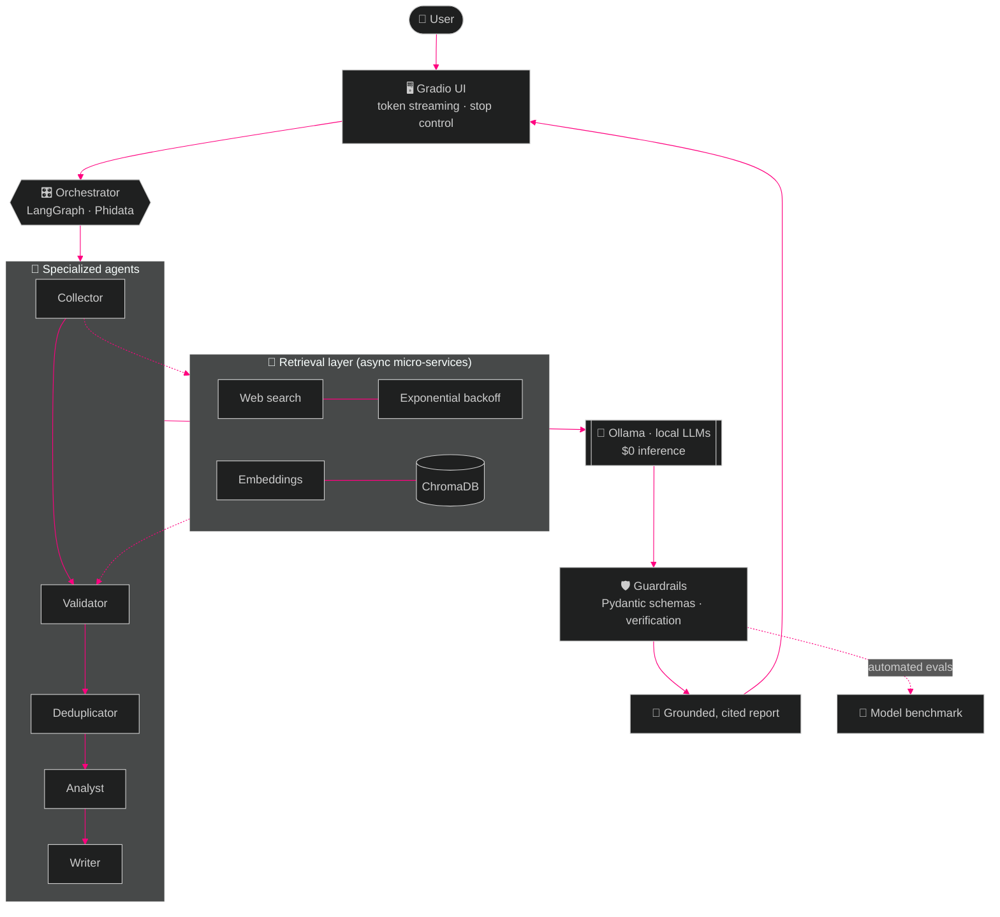
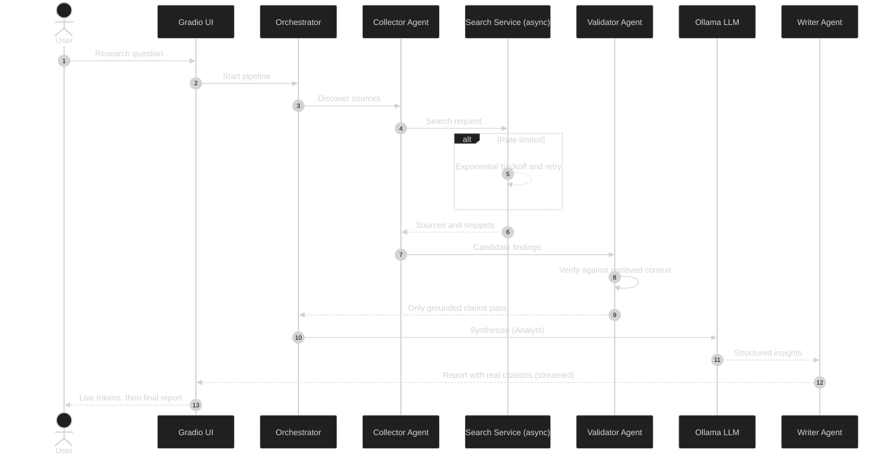
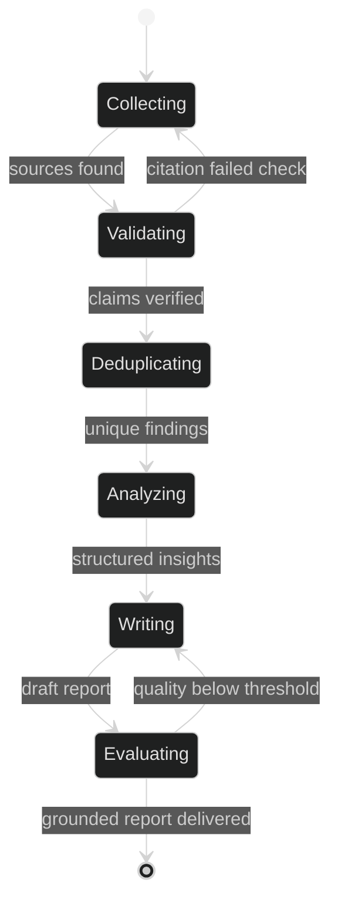
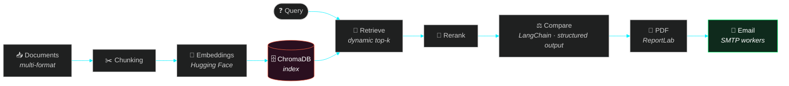
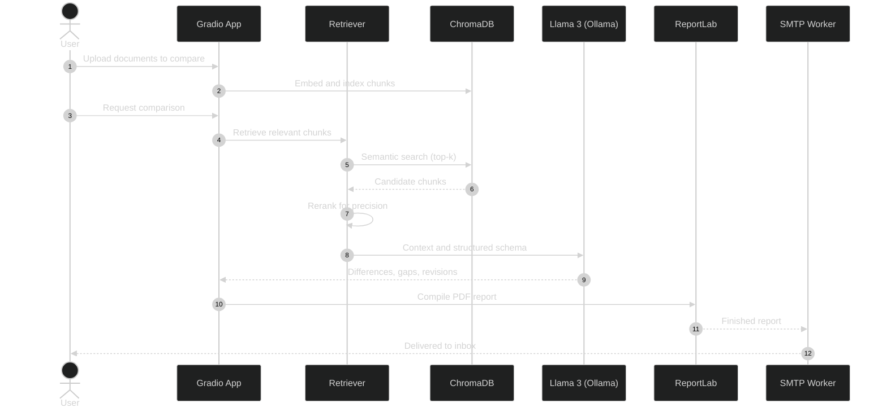
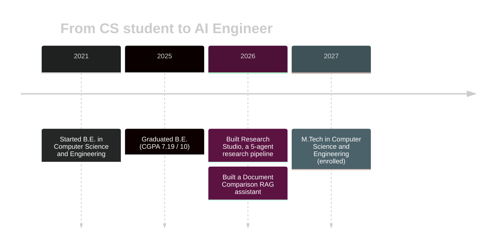
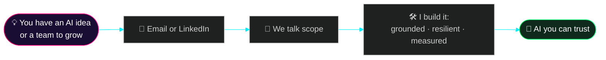

<!-- ===================== HEADER ===================== -->
<div align="center">


<a href="https://github.com/Joyboy1492025">
  
</a>

<br/>

<a href="https://linkedin.com/in/aprathod"></a>
<a href="mailto:adityarathod1425@gmail.com"></a>
<a href="https://github.com/Joyboy1492025?tab=followers"></a>


<br/><br/>


<br/><br/>

<!-- animated terminal (file: assets/terminal.svg) -->


</div>

<br/>

<!-- ===================== QUICK NAV ===================== -->
<div align="center">

<a href="#-about-me"></a>
<a href="#-impact-at-a-glance"></a>
<a href="#-tech-arsenal"></a>
<a href="#-how-my-ai-systems-work"></a>
<a href="#-featured-projects"></a>
<a href="#-github-stats"></a>
<a href="#-lets-connect"></a>

</div>

---

## 👋 About me

I'm a **Computer Science graduate (B.E. 2025, M.Tech in progress)** who builds **production-minded LLM features** in Python: autonomous multi-agent pipelines, end-to-end RAG systems, structured outputs and automated evaluation guardrails.

I care about the unglamorous parts that make AI trustworthy: keeping answers **grounded in retrieved context**, making API calls **resilient**, and **measuring quality** across models.

```python
class AdityaRathod:
    role       = "AI Engineer"
    location   = "Pune, Maharashtra, India"
    focus      = ["Agentic AI", "RAG pipelines", "Local LLM serving"]
    stack      = ["Python", "LangGraph", "LangChain", "Ollama", "ChromaDB"]
    principles = ["Grounded by design", "Local-first", "Resilient by default", "Measured, not guessed"]
    status     = "Open to AI Engineering & LLM Systems roles 🟢"

    def say_hi(self):
        return "Let's build AI you can trust. ✉️  adityarathod1425@gmail.com"
```

<div align="center">

| 🔭 Currently building | 🎯 Looking for | 💬 Ask me about |
|:---|:---|:---|
| Multi-agent research workflows and document-comparison RAG | AI Engineering & LLM Systems roles | Agents, RAG, Ollama, guardrails, evaluation |

</div>

---

## 📊 Impact at a glance

<div align="center">

| 🤖 **5** | 📉 **90%** | 💸 **$0** | ⚡ **&lt; 1s** |
|:---:|:---:|:---:|:---:|
| specialized agents in one research pipeline | fewer rate-limit API failures after decoupling retrieval | external inference cost with local Ollama models | retrieval over indexed documents with ChromaDB |

</div>



---

## 🛠️ Tech arsenal

<div align="center">

**Core**


**Agentic AI & LLM tooling**


</div>

### 🗺️ Skill map



### 📶 Proficiency



<details>
<summary><b>🔍 Click to expand: text skill bars &amp; details</b></summary>
<br/>

```text
Agentic Orchestration (LangGraph, Phidata)  ██████████████████▉░  95%
Local LLM Serving (Ollama)                  ██████████████████▉░  95%
Python                                      ██████████████████▉░  95%
Structured Outputs & Guardrails             ██████████████████░░  94%
RAG & Vector Retrieval                      ██████████████████░░  93%
Prompt Engineering & Evaluation             ██████████████████░░  92%
Vector Databases (ChromaDB)                 ██████████████████░░  90%
FastAPI & Gradio                            ██████████████████░░  90%
CrewAI & AutoGen                            █████████████████░░░  88%
Git, Linux/Bash & Docker                    █████████████████░░░  88%
Hugging Face Transformers                   █████████████████░░░  86%
SQL & DBMS                                  █████████████████░░░  85%
```

| Area | What I do with it |
|---|---|
| **Agentic orchestration** | Autonomous multi-agent discovery, validation, persona delegation, tool calling |
| **Structured outputs & guardrails** | Pydantic / JSON schemas, safety filters, anti-hallucination checks |
| **RAG & vector retrieval** | Dense embeddings, dynamic top-k chunking, reranking, ChromaDB indexing |
| **Local LLM serving** | Llama 3 via Ollama, zero external inference cost, model comparison |
| **Backend & UI** | Async Python micro-services, FastAPI, Gradio token-streaming interfaces |
| **Core CS** | DSA, OOP, DBMS, Operating Systems, SQL |

</details>

---

## 🧠 How my AI systems work

A bird's-eye view of the architecture behind my projects:



### ⏱️ Request lifecycle (with resilient retrieval)



### 🔁 Agent state machine



---

## 🚀 Featured projects

### 01 · 🔬 Research Studio: Multi-Agent AI Research Assistant

     

An autonomous **5-agent pipeline** that performs distributed discovery, synthesis and structured report compilation, with every claim tied back to retrieved sources.

<div align="center">
  
</div>

<details>
<summary><b>✨ Highlights</b></summary>
<br/>

- 🛡️ **Eliminated hallucinated citations** with strict per-agent prompts, validation guardrails and deterministic verification against retrieved context.
- 🔁 **90% fewer rate-limit failures** by moving web retrieval out of LLM tool-calling into async Python micro-services with exponential backoff.
- 📏 **Automated evaluation checks** benchmark output quality across open-source models via local Ollama, at zero external cost.
- 💬 **Gradio UI** with real-time token streaming, pipeline state tracking, stop-generation control and grounded follow-up chat.

</details>

<a href="https://github.com/Joyboy1492025/AI_Analyzer"></a>

<br/>

### 02 · 📄 Document Comparison RAG Assistant with Automated Reporting

     

A high-performance **RAG pipeline** that digests multi-format documents, compares them semantically, and emails a finished PDF report.





<details>
<summary><b>✨ Highlights</b></summary>
<br/>

- ⚡ **Sub-second retrieval**: dense Hugging Face embeddings indexed in ChromaDB.
- 🔍 **Multi-document comparison** with LangChain structured output schemas detects semantic differences, requirement gaps and revisions.
- 🎯 **Dynamic top-k filtering and reranking** improve context precision and answer groundedness.
- 📬 **Automated reporting**: ReportLab PDFs delivered to inboxes by SMTP background workers.

</details>

<a href="https://github.com/Joyboy1492025/Research_Studio"></a>

---

## 🧭 How I build

<div align="center">

| 🛡️ Grounded by design | 🏠 Local-first | 🔁 Resilient by default | 📏 Measured, not guessed |
|:---|:---|:---|:---|
| Strict prompts, guardrails and deterministic checks keep outputs tied to real sources. | Ollama-served models mean $0 inference and freely swappable open-source LLMs. | Async micro-services with exponential backoff, built for flaky APIs. | Automated evals compare models, so improvement shows up in numbers. |

</div>

---

## 🛣️ My journey



<div align="center">

| | |
|---|---|
| 🎯 **M.Tech, Computer Science & Engineering** | Anuradha College of Engineering and Technology · 2027 – 2028 (in progress) |
| 🎓 **B.E., Computer Science & Engineering** | Anuradha College of Engineering and Technology · 2021 – 2025 · CGPA 7.19 / 10 |

</div>

---

## 📈 GitHub stats

<div align="center">


<!-- contribution snake: needs snake.yml in .github/workflows (see setup notes) -->
<picture>
  <source media="(prefers-color-scheme: dark)" srcset="https://raw.githubusercontent.com/Joyboy1492025/Joyboy1492025/output/github-snake-dark.svg" />
  <source media="(prefers-color-scheme: light)" srcset="https://raw.githubusercontent.com/Joyboy1492025/Joyboy1492025/output/github-snake.svg" />
  
</picture>

</div>

---

## 🌐 Explore more

<div align="center">

<!-- Replace the link below with your deployed portfolio URL (GitHub Pages / Netlify / Vercel) -->
<a href="https://Joyboy1492025.github.io"></a>

<sub>My portfolio has a built-in terminal. Try <code>projects</code>, <code>agents</code>, <code>stats</code>, <code>hire</code> or <code>fx matrix</code>. ⌨️</sub>

</div>

---

## 📫 Let's connect

<div align="center">

I'm open to **AI Engineering & LLM Systems roles**. If you're building agents, RAG or local LLM products, I'd love to talk.

</div>



<div align="center">

<a href="mailto:adityarathod1425@gmail.com"></a>
<a href="https://linkedin.com/in/aprathod"></a>

<br/><br/>


<sub>⭐ If something here helped or inspired you, a star on my repos is always appreciated.</sub>

</div>
